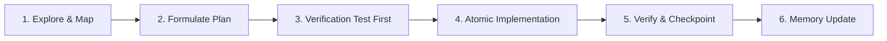

# Superpowers: Disciplined Engineering for AI Coding Agents
*Inspired by [obra/superpowers](https://github.com/obra/superpowers)*

This skill defines the behavioral discipline and workflow gates for AI agents operating in this repository. Agents MUST not modify code arbitrarily or make untested assumptions.

---

## 1. The Core Superpowers Workflow



### Phase 1: Explore & Map
* Never touch code before inspecting existing behavior, imports, and tests.
* Consult `.agents/memory/CODEGRAPH.json` to understand the symbol map and callers/callees of any file you intend to touch.
* Check `.agents/memory/DECISION_RECORDS.md` to ensure your change respects existing architecture choices.

### Phase 2: Formulate Atomic Plan
* Break work into small, independently verifiable increments.
* Avoid massive, multi-file refactors in a single pass.
* Keep edits minimal, reversible, and focused on the stated goal.

### Phase 3: Verification First (TDD)
* Before editing application code, run the test suite:
  ```bash
  npm test
  ```
* If introducing new functionality, write or update test assertions in `tests/portfolio.test.mjs` first to demonstrate the target state.

### Phase 4: Atomic Implementation
* Make the code changes strictly within the identified scope.
* Adhere to Swiss Editorial / Terminal Dark tokens defined in `DESIGN.md`.
* Never inject generic AI boilerplate, excessive obvious comments, or stock placeholder patterns.

### Phase 5: Verification & Quality Gate
* Run all verification checks before calling the task done:
  ```bash
  npm test
  npm run lint
  npm run build
  ```
* If any check fails, immediately diagnose and fix the regression before moving forward.

### Phase 6: Memory & Knowledge Persistence
* Log what was completed, key technical lessons, and newly exposed backlog items in `.agents/AGENT_MEMORY.md`.
* If a new component or export was introduced, refresh the code graph:
  ```bash
  node scripts/generate-codegraph.mjs
  ```
